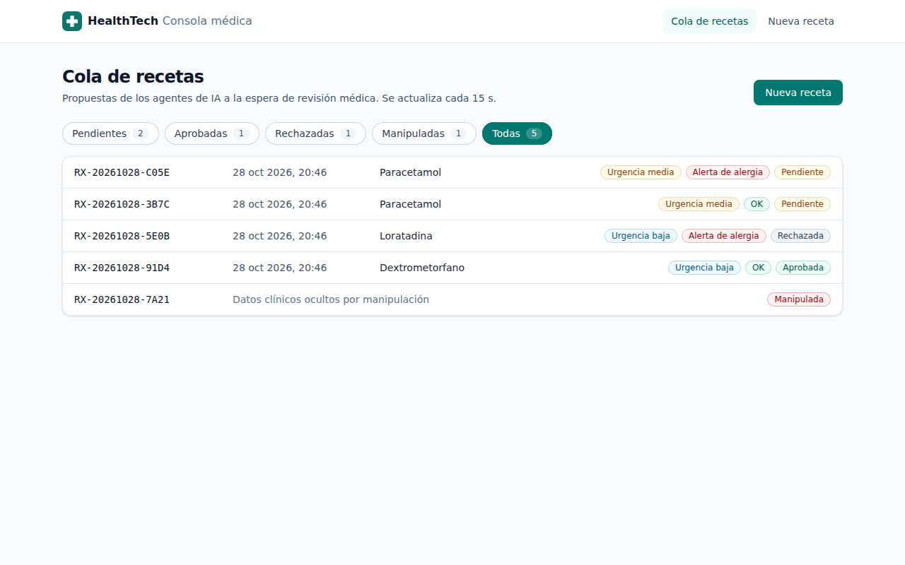
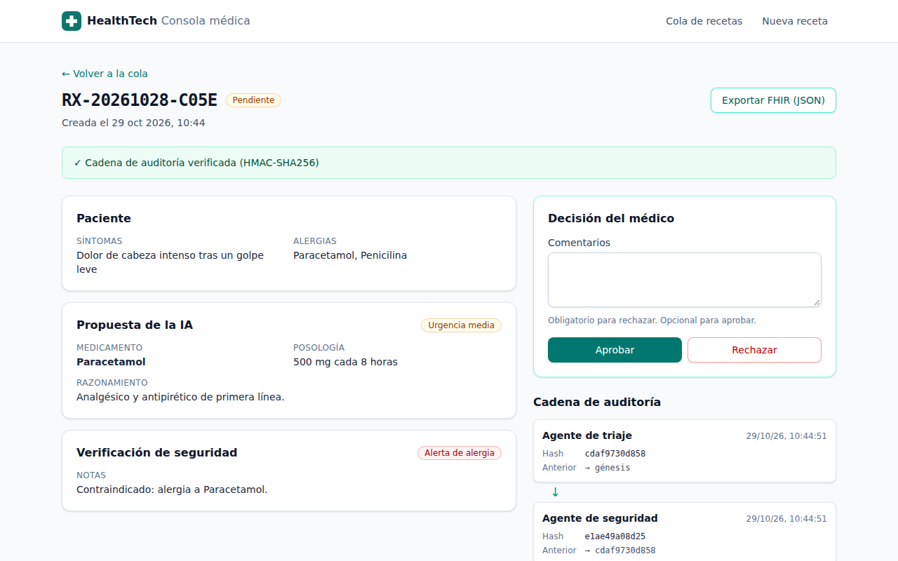
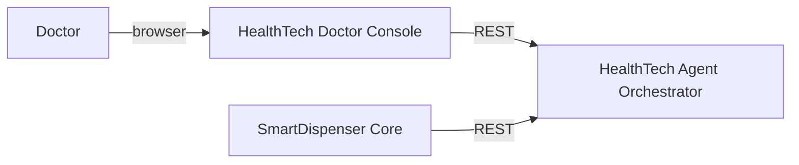

# HealthTech Doctor Console

[](https://github.com/kauan287/healthtech-doctor-console/actions/workflows/ci.yml)
[](LICENSE)

The web console where a doctor reviews prescriptions proposed by AI agents.
The [HealthTech Agent Orchestrator](https://github.com/kauan287/healthtech-agent-orchestrator) runs a triage agent and a safety agent on each request, then holds the prescription until a doctor decides.
This console lists that queue, shows the proposal next to the allergy check, records the approval or rejection, and draws the HMAC-signed audit chain behind every prescription.
If someone edits the orchestrator's database by hand, the API withholds the clinical data and the console shows a red banner with no way to decide, so nobody can approve a forged prescription.

**Live demo.** https://healthtech-doctor-console.onrender.com. The API runs on a free plan that sleeps when idle, so the first request takes about a minute. The console says so while it waits.

The UI text is in Spanish because the demo targets Spanish-speaking clinics. Code and docs are in English.

| Queue                                                                                | Prescription detail                                                                                                |
| ------------------------------------------------------------------------------------ | ------------------------------------------------------------------------------------------------------------------ |
|  |  |

## What this project shows

- One table per domain concept drives the UI. [`src/domain/status.ts`](src/domain/status.ts) maps each API status to its label, badge colour and whether the doctor can still decide. No component branches on a status string to pick a colour.
- The API response is parsed once at the boundary. [`src/domain/prescription.ts`](src/domain/prescription.ts) turns it into a union of `VerifiedPrescription` and `TamperedPrescription`. The API already withholds the clinical fields of a tampered record. The parser also files any record whose `audit_chain_valid` is false as tampered, and `TamperedPrescription` has no clinical fields, so no screen can render them even if a response carried them.
- Types come from the API contract. `npm run gen:api` writes [`src/api/schema.d.ts`](src/api/schema.d.ts) from the orchestrator's OpenAPI document, and CI fails if the committed file drifts.
- Errors read as plain Spanish. [`src/api/errors.ts`](src/api/errors.ts) turns a 409, a 429 with `Retry-After`, or a network failure into a sentence a doctor can act on.
- Component tests run the whole app against [MSW](https://mswjs.io) handlers and assert what the doctor sees. See [`src/pages/DetailPage.test.tsx`](src/pages/DetailPage.test.tsx).
- End-to-end tests drive a real orchestrator with no mocks. [`e2e/console.spec.ts`](e2e/console.spec.ts) approves a prescription, then edits the signed details and timestamps in the SQLite file and checks that the console shows the red banner and offers no decision.

## How it fits the system



- [HealthTech Agent Orchestrator](https://github.com/kauan287/healthtech-agent-orchestrator) is a FastAPI service. It runs the LangGraph agents, stores the signed audit chain, and verifies the chain on every read.
- [SmartDispenser Core](https://github.com/kauan287/smartdispenser-core) reads approved prescriptions from the orchestrator and releases the medication only if the chain is valid.
- This console is the doctor's side. It talks only to the orchestrator's public REST API.

## Run locally

You need Node.js 24 and a running orchestrator. To start the orchestrator in demo mode, which needs no LLM key:

```bash
git clone https://github.com/kauan287/healthtech-agent-orchestrator
cd healthtech-agent-orchestrator
uv sync
ENVIRONMENT=development LLM_PROVIDER=demo DATABASE_URL=sqlite:////tmp/orchestrator.db \
  CORS_ORIGINS=http://localhost:5173,http://localhost:4173 \
  uv run uvicorn src.server:app --port 8000
```

Then start the console:

```bash
npm ci
npm run dev
```

Open http://localhost:5173. To use another API, set `VITE_API_URL`, for example `VITE_API_URL=https://healthtech-orchestrator.onrender.com npm run dev`.

## Testing

| Command               | What it checks                                              |
| --------------------- | ----------------------------------------------------------- |
| `npm run lint`        | ESLint with `typescript-eslint` strict type-checked rules   |
| `npm run typecheck`   | `tsc -b` in strict mode                                     |
| `npm test`            | Vitest component tests with Testing Library and MSW         |
| `npm run test:e2e`    | Playwright against `vite preview` and the real orchestrator |
| `npm run gen:api`     | Regenerates the API types from `$VITE_API_URL/openapi.json` |
| `npm run screenshots` | Regenerates `docs/*.png`                                    |

The end-to-end tests tamper with the orchestrator's database, so they need its SQLite path:

```bash
npx playwright install chromium
ORCHESTRATOR_DB=/tmp/orchestrator.db npm run test:e2e
```

`npm run screenshots` creates fixed prescription ids, so run it against an orchestrator with an empty database.

## Project layout

```text
src/
  api/          openapi-fetch client, React Query hooks, error messages, generated schema
  domain/       prescription union and its parser, status and label tables
  components/   badges, audit timeline, decision panel, layout, wake-up notice
  pages/        queue, detail and new prescription screens, with their tests
  test/         MSW server, fixtures, render helper
e2e/            Playwright tests and the screenshot script
```

Built with Vite, React 19, TypeScript, React Router, TanStack Query, Tailwind CSS, Vitest, MSW and Playwright.

## License

[MIT](LICENSE)
